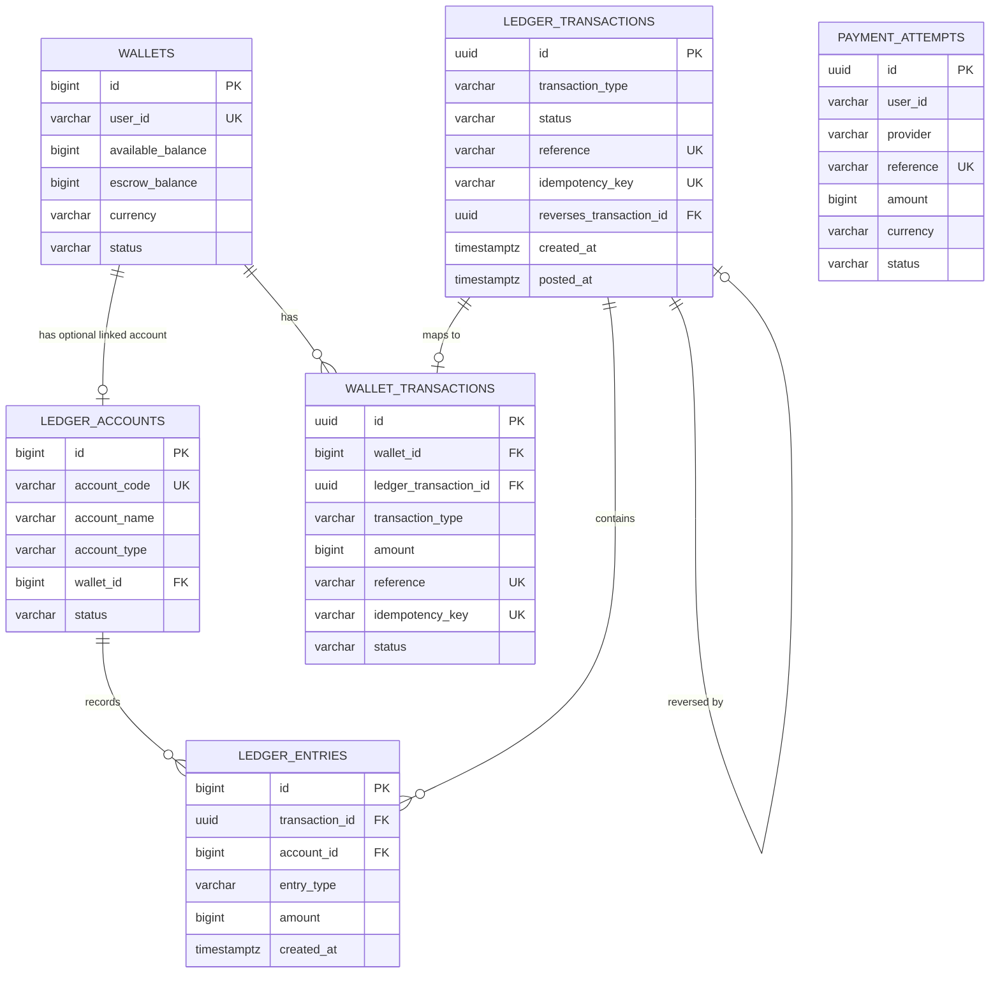

# KoboMarket Database Design

## 1. Overview

KoboMarket uses two databases:

- **MongoDB** stores user accounts, authentication records and product information.
- **PostgreSQL** stores wallets, financial transactions, ledger accounts, ledger entries and payment attempts.

This separation keeps flexible marketplace information separate from financial records that require relational integrity and transactional controls.

All financial amounts are stored in integer Nigerian kobo. Floating-point values must not be used for financial calculations.

## 2. MongoDB Database

MongoDB uses Mongoose models to define and validate application documents.

### 2.1 User collection

Model: `src/modules/users/models/user.model.js`

| Field | Type | Description |
|---|---|---|
| `_id` | ObjectId | MongoDB document identifier |
| `name` | String | Required full name, 2–100 characters |
| `email` | String | Required, unique, lowercase and trimmed |
| `password` | String | Hashed password; excluded from normal queries |
| `role` | String | `customer`, `vendor`, `admin` or `superadmin` |
| `isActive` | Boolean | Account activation status; defaults to true |
| `isEmailVerified` | Boolean | Email verification status; defaults to false |
| `createdAt` | Date | Automatically generated creation timestamp |
| `updatedAt` | Date | Automatically maintained update timestamp |

The email field is unique. Passwords are stored as hashes rather than plain text.

The `customer` role represents the buyer-side account in the current implementation.

### 2.2 EmailVerificationToken collection

Model: `src/modules/auth/models/email-verification-token.model.js`

| Field | Type | Description |
|---|---|---|
| `userId` | ObjectId | Reference to the User collection |
| `tokenHash` | String | Unique SHA-256 hash of the verification token |
| `expiresAt` | Date | Token expiration date |
| `createdAt` | Date | Creation timestamp |
| `updatedAt` | Date | Update timestamp |

Indexes and constraints:

- `userId` is indexed.
- `tokenHash` is unique.
- `expiresAt` has a MongoDB TTL index configured with `expireAfterSeconds: 0`.

The original verification token is sent by email. Only its SHA-256 hash is stored in MongoDB.

MongoDB TTL cleanup is asynchronous. Application logic must still validate token expiration.

### 2.3 RefreshToken collection

Model: `src/modules/auth/models/refresh-token.model.js`

| Field | Type | Description |
|---|---|---|
| `userId` | ObjectId | Reference to the User collection |
| `tokenHash` | String | Unique SHA-256 hash of the refresh token |
| `familyId` | String | Identifies a group of related session tokens |
| `revokedAt` | Date | Revocation timestamp; defaults to null |
| `replacedByTokenHash` | String | Hash of a replacement token; defaults to null |
| `expiresAt` | Date | Token expiration date |
| `createdAt` | Date | Creation timestamp |
| `updatedAt` | Date | Update timestamp |

Indexes:

- `userId` is indexed.
- `familyId` is indexed.
- A compound index supports queries by `userId` and `familyId`.
- A TTL index automatically removes expired records.

The schema provides fields needed for refresh-token rotation and reuse detection. However, the current service creates refresh-token sessions without implementing the complete rotation, reuse-detection and revocation workflow.

### 2.4 Product collection

Model: `src/modules/products/models/product.model.js`

| Field | Type | Description |
|---|---|---|
| `_id` | ObjectId | MongoDB document identifier |
| `vendor` | ObjectId | Reference to the User collection |
| `name` | String | Required product name, 3–150 characters |
| `description` | String | Required description, 20–5,000 characters |
| `category` | String | Required product category |
| `priceKobo` | Number | Positive safe integer representing price in kobo |
| `currency` | String | NGN only |
| `stockQuantity` | Number | Non-negative whole-number inventory quantity |
| `status` | String | `draft`, `active` or `archived` |
| `imageUrls` | Array | Up to eight product image URLs |
| `createdAt` | Date | Creation timestamp |
| `updatedAt` | Date | Update timestamp |

Indexes:

- `vendor` supports vendor-related queries.
- `{ vendor: 1, createdAt: -1 }` supports vendor product listing.
- `{ status: 1, category: 1, createdAt: -1 }` supports marketplace filtering.
- A text index covers `name` and `description`.

Product prices use integer kobo to avoid floating-point rounding problems.

The current product schema does not yet implement every assignment requirement. Slugs, variants, tags and rating summaries remain planned enhancements.

## 3. PostgreSQL Database

PostgreSQL stores the financial records and enforces relational constraints.

Knex.js manages database migrations and queries.

Migration directory:

`src/database/migrations/`

### 3.1 wallets

Migration: `20261106200859_create_wallets_table.js`

| Field | Type | Description |
|---|---|---|
| `id` | BIGINT | Auto-incrementing primary key |
| `user_id` | VARCHAR(50) | Unique MongoDB user ID |
| `available_balance` | BIGINT | Spendable wallet balance in kobo |
| `escrow_balance` | BIGINT | Escrow balance in kobo |
| `currency` | VARCHAR(3) | Defaults to NGN |
| `status` | VARCHAR(20) | `active` or `frozen` |
| `created_at` | TIMESTAMPTZ | Creation timestamp |
| `updated_at` | TIMESTAMPTZ | Update timestamp |

Constraints:

- `user_id` is unique.
- `available_balance` must be zero or greater.
- `escrow_balance` must be zero or greater.
- `status` must be `active` or `frozen`.

The `user_id` column stores the MongoDB user's identifier as a string. It is a logical cross-database reference, not a PostgreSQL foreign key.

### 3.2 ledger_accounts

Migration: `20261107031932_create_ledger_accounts_table.js`

| Field | Type | Description |
|---|---|---|
| `id` | BIGINT | Auto-incrementing primary key |
| `account_code` | VARCHAR(20) | Unique account code |
| `account_name` | VARCHAR(100) | Account name |
| `account_type` | VARCHAR(20) | Asset, liability, equity, revenue or expense |
| `description` | TEXT | Account description |
| `status` | VARCHAR(20) | `active` or `inactive` |
| `wallet_id` | BIGINT | Optional reference to a wallet |
| `created_at` | TIMESTAMPTZ | Creation timestamp |
| `updated_at` | TIMESTAMPTZ | Update timestamp |

The later migration `20261107032620_link_ledger_accounts_to_wallets.js` adds `wallet_id`.

The `wallet_id` relationship is optional and unique. This allows platform-level ledger accounts to exist without belonging to an individual wallet.

When present, `wallet_id` references `wallets.id` with `ON DELETE RESTRICT`.

### 3.3 ledger_transactions

Migration: `20261107033720_create_ledger_transactions_table.js`

| Field | Type | Description |
|---|---|---|
| `id` | UUID | Primary key |
| `transaction_type` | VARCHAR(50) | Financial operation type |
| `status` | VARCHAR(20) | `pending`, `posted` or `reversed` |
| `reference` | VARCHAR(150) | Optional unique external reference |
| `idempotency_key` | VARCHAR(150) | Optional unique idempotency key |
| `description` | TEXT | Transaction description |
| `created_at` | TIMESTAMPTZ | Creation timestamp |
| `posted_at` | TIMESTAMPTZ | Posting timestamp; nullable before posting |
| `reverses_transaction_id` | UUID | Optional reference to the original transaction |

The `reverses_transaction_id` column is added by migration `20261110110000_add_ledger_transaction_reversals.js`.

Supported transaction types include:

- `wallet_funding`
- `purchase`
- `commission`
- `refund`
- `payout`
- `adjustment`
- `reversal` (added by the reversal migration)

The original migration defines the initial transaction types. The later reversal migration extends that list.

Constraints and indexes:

- `id` is the primary key.
- `reference` is unique when supplied.
- `idempotency_key` is unique when supplied.
- A posted transaction must have a `posted_at` timestamp.
- The status and transaction type are restricted to recognised values.
- An index supports queries by `status` and `created_at`.
- A transaction can have at most one reversal through a unique partial index on the reversal reference.
- A transaction cannot reverse itself.

A reversal creates a separate transaction with opposite debit and credit entries. The original posted ledger entries are not edited or deleted.

### 3.4 ledger_entries

Initially created by migration `20261107030253_create_ledger_entries_table.js`.

The later migration `20261107033231_link_ledger_entries_to_accounts.js` replaces the original wallet relationship with an account relationship.

Final structure:

| Field | Type | Description |
|---|---|---|
| `id` | BIGINT | Auto-incrementing primary key |
| `transaction_id` | UUID | Reference to `ledger_transactions.id` |
| `account_id` | BIGINT | Reference to `ledger_accounts.id` |
| `entry_type` | VARCHAR(10) | `debit` or `credit` |
| `amount` | BIGINT | Positive amount in kobo |
| `description` | TEXT | Entry description |
| `created_at` | TIMESTAMPTZ | Entry creation timestamp |

Constraints:

- `transaction_id` references `ledger_transactions.id`.
- `account_id` references `ledger_accounts.id`.
- Both foreign keys use `ON DELETE RESTRICT`.
- `entry_type` must be `debit` or `credit`.
- `amount` must be greater than zero.

Indexes support transaction lookups and account history.

A financial transaction can contain multiple ledger entries. The ledger service and PostgreSQL integrity triggers enforce balanced debit and credit totals before a transaction is posted.

Posted ledger entries are protected against updates and deletion. Corrections are recorded using reversal transactions.

### 3.5 wallet_transactions

Migration: `20261108083223_create_wallet_transactions_table.js`

| Field | Type | Description |
|---|---|---|
| `id` | UUID | Primary key |
| `wallet_id` | BIGINT | Reference to `wallets.id` |
| `transaction_type` | String | Funding, purchase, refund, payout or adjustment |
| `amount` | BIGINT | Positive amount in kobo |
| `reference` | String | Unique transaction reference |
| `idempotency_key` | String | Unique idempotency key when supplied |
| `ledger_transaction_id` | UUID | Unique reference to a ledger transaction |
| `status` | String | Pending, completed, failed or reversed |
| `description` | TEXT | Transaction description |
| `created_at` | TIMESTAMPTZ | Creation timestamp |
| `updated_at` | TIMESTAMPTZ | Update timestamp |

The wallet and ledger references use foreign keys with `ON DELETE RESTRICT`.

The unique `ledger_transaction_id` ensures a wallet transaction cannot be linked to more than one ledger transaction, and a ledger transaction cannot be linked to multiple wallet transaction records through this column.

### 3.6 payment_attempts

Migration: `20261111111900_create_payment_attempts_table.js`

| Field | Type | Description |
|---|---|---|
| `id` | UUID | Primary key |
| `user_id` | VARCHAR(50) | MongoDB user identifier |
| `provider` | String | Paystack |
| `reference` | String | Unique payment reference |
| `idempotency_key` | String | Unique idempotency key |
| `amount` | BIGINT | Positive payment amount in kobo |
| `currency` | String | NGN |
| `status` | String | Pending, success or failed |
| `authorization_url` | String | Payment authorization URL |
| `access_code` | String | Payment access code |
| `verified_at` | TIMESTAMPTZ | Payment verification timestamp |
| `created_at` | TIMESTAMPTZ | Creation timestamp |
| `updated_at` | TIMESTAMPTZ | Update timestamp |

Constraints and indexes:

- `reference` is unique.
- `idempotency_key` is unique when supplied.
- `amount` must be greater than zero.
- `provider` is restricted to Paystack.
- `currency` is restricted to NGN.
- `status` is restricted to pending, success or failed.
- An index supports retrieving a user's payment attempts by creation date.

The `user_id` field is a logical reference to MongoDB. It is not a PostgreSQL foreign key.

## 4. PostgreSQL Entity Relationship Diagram

The following diagram represents the principal relationships in the current PostgreSQL schema.



The diagram shows PostgreSQL foreign-key relationships. MongoDB user references are logical associations and are therefore not shown as PostgreSQL foreign keys.

## 5. Cross-Database Relationships

MongoDB and PostgreSQL do not share a single relational transaction.

The application connects records using MongoDB user IDs stored as strings in PostgreSQL.

Two important examples are:

1. `wallets.user_id` identifies the MongoDB user who owns a wallet.
2. `payment_attempts.user_id` identifies the MongoDB user associated with a payment attempt.

The application is responsible for validating these logical relationships.

During registration, the application creates the MongoDB user and then creates the corresponding PostgreSQL wallet. The registration service includes reconciliation and compensation handling for wallet-creation failures.

This is not a general-purpose distributed transaction or complete transactional outbox implementation.

## 6. Ledger Design and Financial Integrity

KoboMarket uses a double-entry ledger.

Each posted financial transaction must contain at least two ledger entries, and total debits must equal total credits.

For example, when a customer funds a wallet, the accounting movement is conceptually:

| Account | Entry | Amount |
|---|---|---:|
| Paystack Clearing | Debit | ₦5,000 |
| Customer Wallet Liability | Credit | ₦5,000 |

The example illustrates the accounting direction; actual account identifiers and amounts depend on the transaction being processed.

Financial amounts are stored as integer kobo in PostgreSQL BIGINT columns.

Database protections include:

- Positive ledger entry amounts.
- Debit and credit entry types only.
- Balanced entries before posting.
- Append-only protection for ledger entries.
- Restrictions on changing posted transaction headers.
- Controlled transaction status transitions.
- Reversal transactions for correcting posted entries.
- Unique references and idempotency keys where supplied.

The wallet table also has non-negative balance constraints.

## 7. System Ledger Accounts

The current seed file is:

`src/database/seeds/system_ledger_accounts.js`

It defines these four system accounts:

| Account code | Account name | Account type |
|---|---|---|
| SYS-001 | Paystack Clearing | Asset |
| SYS-002 | Escrow Liability | Liability |
| SYS-003 | Platform Commission Revenue | Revenue |
| SYS-004 | Payment Processing Fees | Expense |

The seed uses conflict handling to avoid inserting duplicate account codes.

The current seed does not yet define a separate payout-clearing account.

## 8. Migration Management

Knex manages PostgreSQL schema migrations.

Migration files are stored in:

`src/database/migrations/`

The migration history is recorded in the `knex_migrations` table.

The project uses separate PostgreSQL database configuration for development, ordinary tests and payment integration tests.

The database migration command is:

```bash
npm run migrate
```

The available system ledger account seed can be executed with:

```bash
npx knex seed:run
```

Run migrations and seeds against the intended database environment. Do not run test migrations against a production database.

## 9. Database Testing

Database-related tests are located under:

`src/tests/`

The project includes tests for authentication, products, wallet and ledger behaviour, payment processing and PostgreSQL integration.

Payment API integration tests use a separate Jest configuration and dedicated test database settings.

The test database configuration is designed to keep ordinary test data and payment integration test data separate from development data.

## 10. Current Database Scope and Planned Extensions

The current database implementation provides the foundation for authentication, products, wallets, double-entry ledger records and Paystack payment attempts.

The following assignment requirements are not yet represented by complete database modules and workflows:

- Vendor applications and approval records.
- Product variants, tags, slugs and rating summaries.
- Shopping carts and cart items.
- Orders and vendor suborders.
- Escrow records and order-to-escrow relationships.
- Disputes and refunds.
- Vendor payouts and payout-clearing accounts.
- Reviews and customer notifications.
- Full marketplace administration and reporting records.

These are planned extensions, not existing tables or collections.

## 11. Conclusion

The current database design separates flexible marketplace information from financial records.

MongoDB provides document storage for users, authentication records and products. PostgreSQL provides relational storage and integrity controls for wallets, ledger accounts, ledger transactions, ledger entries, wallet transactions and payment attempts.

The design prioritises integer-kobo financial values, relational constraints, idempotency, balanced ledger entries and controlled reversal of posted financial transactions.
